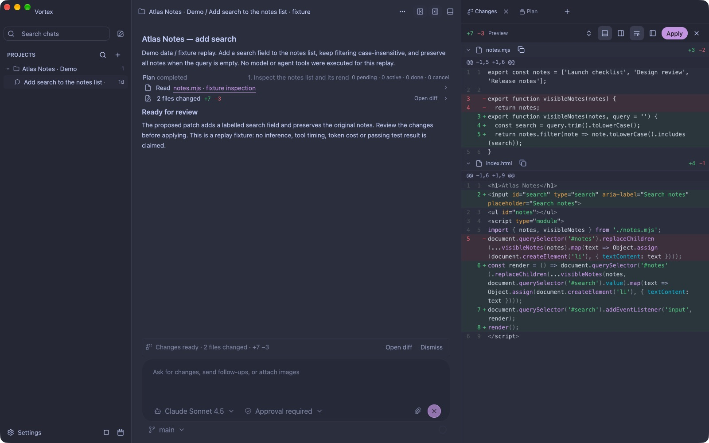

# Vortex

Vortex is a native desktop workspace for transparent local agent workflows. It
combines project indexing, event-sourced sessions, approval-gated tools,
native patch-first edits, Codex-owned execution, and an inspectable activity timeline
in one Rust/GPUI app.

<p align="center">
  
</p>

*The real app with isolated sample data and a proposed patch. This offline replay
does not run a model or apply changes. [Reproduce the screenshot](docs/screenshot-demo.md).*

> Early-stage developer preview. Production readiness is tracked in the
> [release checklist](docs/production-readiness.md).

## Highlights

- Native macOS desktop UI built with Rust, GPUI, and `gpui-component`.
- Threaded agent sessions with project context, plans, tool activity, and
  generated changes kept visible.
- Native patch-first editing, plus approval previews and observed completed diffs
  for Codex-owned edits.
- Approval and sandbox policies for risky tools and real process execution.
- Event-sourced local sessions stored outside the repository in SQLite.
- Native Codex agent integration using your existing Codex CLI login, with automatic
  reconnection and conversation resume.
- OpenRouter-backed model calls when `OPENROUTER_API_KEY` is set, with a mock
  provider fallback for local UI exploration.

## Safety Model

Vortex is built to keep agent activity inspectable. The following patch-first
guarantees describe the native backend; [Codex execution](docs/codex-backend.md)
uses Codex-owned tools, approvals, and observed diffs:

- Provider streams are normalized into `AgentEvent` before UI rendering.
- Writes are represented as previewable patches before apply.
- Dangerous commands require approval.
- Runtime sessions are replayable from SQLite event data.
- Secrets are read from environment variables only and should never be
  committed.

The deeper runtime contracts live in:

- [Context and tool contract](docs/context-and-tool-contract.md)
- [Edit transaction contract](docs/edit-transaction-contract.md)
- [Agent guide](AGENTS.md)

## Requirements

- macOS, the primary development target.
- Rust stable with Edition 2024 support. The repository pins `stable` plus
  `rustfmt` and `clippy` in [rust-toolchain.toml](rust-toolchain.toml).
- Xcode command line tools for native macOS linking.

## Setup

From a fresh clone, install the pinned Rust toolchain components and verify the
desktop app:

```bash
rustup show
cargo check -p app
```

For Codex, install the official [Codex CLI](https://developers.openai.com/codex/cli),
then authenticate once:

```bash
codex login
cargo run -p app
```

Vortex reuses Codex-managed authentication. Select **Codex** in Settings → Models;
new installations select it automatically and show sign-in guidance when needed. Choose a model and
reasoning level, then use Plan or Apply with approval. Conversations resume after
restart without repeating login while credentials remain valid. See
[Codex setup, permissions, and recovery](docs/codex-backend.md).
Finder launches also discover Homebrew, local npm, Volta, and NVM installations;
use `VORTEX_CODEX_BIN=/absolute/path/to/codex` to override discovery.

No `.env` file is required or loaded. For the alternative OpenRouter backend,
export a key before starting the app:

```bash
export OPENROUTER_API_KEY=...
cargo run -p app
```

Without `OPENROUTER_API_KEY`, the native backend uses Mock; the independent Codex
backend remains available with an authenticated Codex CLI.

## Running

Run from the repository root:

```bash
cargo run -p app
```

The app writes local runtime state outside the repository. To reset local app
state during development, stop the app and move or delete `~/.config/vortex/`.
Do not commit local databases, logs, traces, or generated build output.

Useful development commands:

```bash
cargo fmt --all --check
cargo clippy --workspace --all-targets
cargo check -p app
cargo test --workspace
```

## Optional configuration

| Variable | Purpose |
| --- | --- |
| `VORTEX_CODEX_BIN` | Optional path to the installed Codex executable when it is not on PATH. |
| `OPENROUTER_API_KEY` | Enables real OpenRouter model calls. If omitted, the mock provider is used. |
| `PAGEINDEX_API_KEY` | Optional key for hosted document/PDF context provider experiments. |
| `EXA_API_KEY` | Optional key for Exa-backed web search tools. |
| `TAVILY_API_KEY` | Optional key for Tavily-backed web search tools. |
| `JINA_API_KEY` | Optional key for Jina-backed URL extraction. |
| `FIRECRAWL_API_KEY` | Optional key for Firecrawl-backed URL extraction. |
| `VORTEX_CONTEXT_SELECTION` | Set to `1`, `true`, or `yes` to enable context-selection prompt behavior. |
| `VORTEX_RENDER_PROFILE` | Set to `1` or `true` to enable render profiling instrumentation. |
| `VORTEX_BROWSER_MCP_COMMAND` | Optional command used to start a browser MCP stdio server. If omitted, browser tools are disabled with a clear tool denial. |
| `VORTEX_BROWSER_MCP_ARGS` | Optional JSON array of string arguments for `VORTEX_BROWSER_MCP_COMMAND`. |
| `VORTEX_BROWSER_MCP_SNAPSHOT_TOOL` | MCP tool name that backs Vortex's `browser_snapshot` tool. Required when `VORTEX_BROWSER_MCP_COMMAND` is set. |
| `VORTEX_BROWSER_MCP_SCREENSHOT_TOOL` | MCP tool name that backs Vortex's `browser_screenshot` tool. Required when `VORTEX_BROWSER_MCP_COMMAND` is set. |

Runtime data is stored outside the repository in `~/.config/vortex/`. If the
home directory cannot be resolved, the app falls back to `.vortex/`, which is
ignored by Git.

Example browser MCP configuration:

```bash
export VORTEX_BROWSER_MCP_COMMAND=...
export VORTEX_BROWSER_MCP_ARGS='["arg-one","arg-two"]'
export VORTEX_BROWSER_MCP_SNAPSHOT_TOOL=...
export VORTEX_BROWSER_MCP_SCREENSHOT_TOOL=...
cargo run -p app
```

## Repository layout

```text
crates/
  agent_protocol/    Shared command, event, tool, risk, and status types
  agent_store/       SQLite event log and session/project persistence
  agent_core/        Native runtime state machine and model loop
  agent_codex/       Local Codex agent process, approvals, and recovery
  agent_models/      Mock and OpenRouter providers
  agent_tools/       Tool registry and tool executors
  agent_sandbox/     Risk, approval, path, and secret policies
  agent_context/     Prompt and context builder
  agent_shell/       Rust-native virtual shell
  agent_eval/        Evaluation harness and runtime scenarios
  real_process/      Approved real command executor
  project_index/     File walk, search, summaries, and project index cache
  context_providers/ Context provider service and adapters
  terminal/          Terminal core and renderer
  android_device/    Android observation and action helpers
  app/               GPUI desktop shell
docs/                Architecture, runtime, editing, release, and performance notes
```

## Production readiness

Vortex is designed around safety boundaries, but a production release should be
cut only after the release owner verifies the current branch against the full
checklist in [Production readiness](docs/production-readiness.md).

## Public repo hygiene

Before pushing a public repository:

1. Run `git status --short --branch` and confirm only intentional files are
   changed.
2. Run a secret scan over tracked files and history, for example with
   `gitleaks detect --source .` or an equivalent scanner.
3. Keep credentials in your shell or OS keychain, not in `.env` or committed
   config.
4. Confirm generated outputs such as `target/`, `node_modules/`, logs, traces,
   and local SQLite files are ignored.
5. Confirm `Cargo.lock` is tracked and up to date.

This repository includes ignore rules for common local artifacts and a
[security policy](SECURITY.md) for private vulnerability reports.

## License

Vortex is open source under the [MIT License](LICENSE).
