# Main Thread UI Report

Generated from the current codebase on 2026-06-25. This report uses direct inspection plus two subagent code-reading passes:

- Subagent 1: chat/thread rendering, manifest, row variants, virtual list, scroll/caches.
- Subagent 2: agent modes, reducer event mapping, approvals, subagent/task delegation, activity UI.

Primary source files:

- `crates/app/src/window/render.rs`
- `crates/app/src/window/orchestration/agent_run.rs`
- `crates/app/src/window/bridge/thread_bridge.rs`
- `crates/app/src/window/bridge/subagent_bridge.rs`
- `crates/app/src/agent/reducer.rs`
- `crates/app/src/features/chat/thread_view/{mod.rs,render.rs,rows.rs,sync.rs,caches.rs,scroll.rs}`
- `crates/app/src/features/chat/manifest.rs`
- `crates/app/src/features/chat/state.rs`
- `crates/app/src/features/shell/state.rs`
- `crates/app/src/features/agent_activity/components/*`
- `crates/agent_protocol/src/{event.rs,mode.rs,command.rs}`

---

## 1. Executive summary

The main thread UI is an event-normalized, virtualized transcript. Provider/runtime events are **not rendered directly**. They are transformed in stages:

1. `agent_protocol::AgentEvent` arrives from the runtime.
2. `AgentWindow` reducer normalizes it into plain `ThreadItem` data on the active `Conversation`.
3. `ThreadView` projects `ThreadItem`s into a flat `Vec<RowRef>` manifest.
4. `v_virtual_list` renders only visible rows.
5. Row renderers delegate visual details to `features/chat/components` and `features/agent_activity/components`.

The UI style is intentionally IDE-like and flat:

- User messages are flat rows with a small accent rail.
- Assistant messages are flat markdown text on the thread background.
- Reasoning/tool/diff/context/subagent rows are compact timeline/activity rows.
- Cards are reserved for blocking/input surfaces such as the composer approval card and choice request card.
- The composer is an elevated input surface over the bottom of the thread.

Important current-code note: the repository guide describes a hot-tail layer for streaming assistant text, but the inspected implementation currently renders streaming assistant text **inline in the same virtual list** and optimizes it with coalesced row patching/caches.

---

## 2. Main architecture flow

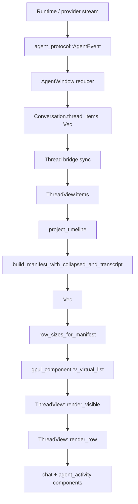

### Ownership boundaries

| Layer | Type/path | Responsibility |
| --- | --- | --- |
| Runtime protocol | `crates/agent_protocol/src/event.rs` | Stream-normalized agent events. |
| Window state | `crates/app/src/window/mod.rs` | Owns mutable app state, selected mode/model, pending approvals, inspector/diff state. |
| Reducer | `crates/app/src/agent/reducer.rs` | Converts `AgentEvent` into `ThreadItem`, status, diff, approval, plan, task state. |
| Pure thread data | `crates/app/src/features/shell/state.rs` | `Conversation`, `ThreadItem`, `AgentStatus`, plan/todo/context schemas. |
| Thread sync bridge | `crates/app/src/window/bridge/thread_bridge.rs` | Keeps `Conversation.thread_items`, `ThreadView`, and subagent projections synchronized. |
| Thread view | `crates/app/src/features/chat/thread_view/*` | Stateful GPUI view: manifest, row sizes, scroll, caches, streaming patches. |
| Manifest | `crates/app/src/features/chat/manifest.rs` | Flattens items into virtual-list rows and estimates heights. |
| Row components | `features/chat/components`, `features/agent_activity/components` | Stateless leaf visual components. |

---

## 3. Window layout: where the thread sits

The top-level render path is `AgentWindow::render` in `crates/app/src/window/render.rs`.

Simplified layout:

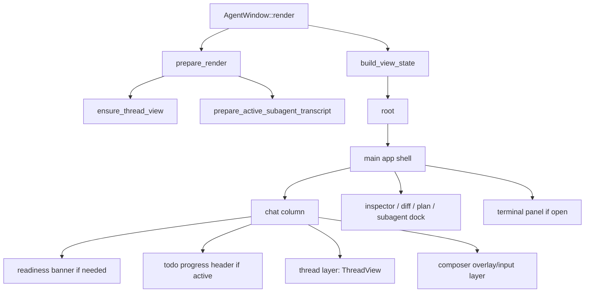

The chat column is effectively:

```text
chat_column
  ├─ workspace readiness banner, if needed
  ├─ todo_progress_header, if active todos exist
  ├─ thread_layer -> ThreadView
  └─ composer_layer -> render_composer
```

The thread itself renders a full-size `thread-surface` with a centered `thread-list`. In main chrome it uses:

- horizontal padding: `Tokens::thread_padding_x()`
- top padding: `Tokens::thread_padding_top()`
- max width: `Tokens::THREAD_MAX_WIDTH`
- bottom fade over the composer: `render_composer_fade(self.composer_thread_inset_px())`

Embedded thread views, such as subagent inspector transcripts, use tighter `Tokens::spacing_3()` padding.

---

## 4. Core schemas

### 4.1 `AgentMode` protocol schema

Source: `crates/agent_protocol/src/mode.rs`

```rust
pub enum AgentMode {
    ChatOnly,
    ReadOnlyInspect,
    PlanOnly,
    SuggestPatch,
    ApplyWithApproval,
    AutoSafe,
    FullAccessDangerous,
}
```

Capabilities:

| Mode | Read files | Virtual bash | Propose patches | Apply patches | Real commands | Auto-apply patches |
| --- | --- | --- | --- | --- | --- | --- |
| `ChatOnly` | No | No | No | No | No | No |
| `ReadOnlyInspect` | Yes | Yes | No | No | No | No |
| `PlanOnly` | Yes | Yes | No | No | No | No |
| `SuggestPatch` | Yes | Yes | Yes | No | No | No |
| `ApplyWithApproval` | Yes | Yes | Yes | Yes | Yes | No |
| `AutoSafe` | Yes | Yes | Yes | Yes | Yes | No |
| `FullAccessDangerous` | Yes | Yes | Yes | Yes | Yes | Yes |

Default: `ApplyWithApproval`.

### 4.2 Composer mode chip schema

Source: `crates/app/src/features/composer/components/mode_chips.rs`

The composer exposes five compact chips:

| Chip | Protocol mode | Tooltip body | Selected accent |
| --- | --- | --- | --- |
| `Plan` | `PlanOnly` | “Read-only planning — research the codebase and draft an implementation plan.” | primary text |
| `Ask` | `ChatOnly` | “Chat only — answers questions without tools, edits, or commands.” | primary text |
| `Edit` | `SuggestPatch` | “Suggest edits — propose diffs and previews without applying changes.” | warning |
| `Apply` | `ApplyWithApproval` | “Default mode — runs tools and applies patches after you approve them.” | danger |
| `Agent` | `FullAccessDangerous` | “Full access — auto-runs tools and applies changes with minimal gates.” | danger |

Visual details:

- row id: `composer-mode-chips`
- chip height: `Tokens::COMPOSER_MODE_CHIP_HEIGHT`
- horizontal padding: `Tokens::spacing_2()`
- gap: `Tokens::spacing_1p5()`
- rounded: `Tokens::radius_full()`
- selected chips get a tinted background and subtle border
- unselected chips use tertiary text and hover surface

Settings expose a slightly different list: `ApplyWithApproval`, `ReadOnlyInspect`, `SuggestPatch`, `PlanOnly`, `AutoSafe`. Composer exposes `ChatOnly` and `FullAccessDangerous`; settings expose `ReadOnlyInspect` and `AutoSafe`.

### 4.3 `AgentEvent` schema relevant to thread UI

Source: `crates/agent_protocol/src/event.rs`

```rust
pub enum AgentEvent {
    RunStarted { run_id, session_id, model, mode, depth, parent_run_id },
    ContextBuilt { run_id, token_estimate, files, summaries, section_estimates },
    AssistantTextDelta { run_id, text },
    ReasoningDelta { run_id, text },
    ToolCallStarted { run_id, call_id, name, args_preview, dedupe_key, risk },
    ToolCallUpdated { run_id, call_id, args_preview, dedupe_key },
    ToolOutputDelta { run_id, call_id, stream, chunk },
    ToolCallFinished { run_id, call_id, status, summary, body },
    ApprovalRequested { run_id, approval_id, call_id, risk, reason, command_preview, affected_paths },
    ChoiceRequested { run_id, choice_id, prompt, options, summary, recommended_option_id, allow_custom, blocking_reason },
    PatchPreviewUpdated { call_id, unified_diff },
    PatchProposed { patch_id, files, unified_diff, risk },
    PatchApplied { patch_id, files },
    TodoUpdated { run_id, todos },
    ContextTrace { run_id, entries },
    PlanUpdated { run_id, markdown, created_at },
    SubagentStarted { parent_run_id, child_run_id, call_id, model, task },
    SubagentFinished { parent_run_id, child_run_id, call_id, status, summary },
    UsageUpdated { run_id, input_tokens, output_tokens, cache_read_tokens, cache_write_tokens, estimated_cost_usd },
    RunFinished { run_id, status },
    RunFailed { run_id, error },
    CommandFailed { message },
}
```

### 4.4 `ThreadItem` schema

Source: `crates/app/src/features/shell/state.rs`

```rust
pub enum ThreadItem {
    UserMessage {
        id: String,
        text: String,
        attachments: Vec<MessageAttachment>,
        expanded: bool,
    },
    AssistantMessage {
        id: String,
        markdown: String,
        streaming: bool,
        depth: u8,
        parent_call_id: Option<String>,
    },
    SubagentRun {
        id: String,
        task: String,
        model: String,
        summary: String,
        expanded: bool,
        status: AgentStatus,
        child_run_id: String,
        parent_call_id: String,
    },
    ReasoningStep {
        id: String,
        title: String,
        summary: String,
        expanded: bool,
        status: AgentStatus,
        depth: u8,
        parent_call_id: Option<String>,
    },
    ToolCall {
        id: String,
        tool_name: String,
        command: Option<String>,
        output: Option<String>,
        expanded: bool,
        status: AgentStatus,
        depth: u8,
        parent_call_id: Option<String>,
    },
    DiffSummary {
        id: String,
        files_changed: usize,
        additions: usize,
        deletions: usize,
        files: Vec<DiffFileSummary>,
        expanded: bool,
        depth: u8,
        parent_call_id: Option<String>,
    },
    RunError {
        id: String,
        message: String,
        session_ref: Option<String>,
        retryable: bool,
    },
    ChoiceRequest {
        id: String,
        prompt: String,
        options: Vec<ChoiceOption>,
        meta: ChoiceMeta,
        selected: Option<String>,
        resolved: bool,
    },
    ApprovalRequest {
        id: String,
        title: String,
        risk: ApprovalRisk,
        resolved: bool,
    },
    TodoList {
        id: String,
        items: Vec<TodoEntry>,
    },
    PlanStatus {
        id: String,
        state: PlanExecutionState,
        summary: String,
        counts: PlanProgressCounts,
        source_conversation_id: Option<ConversationId>,
    },
    ContextTrace {
        id: String,
        entries: Vec<ContextTraceEntry>,
        expanded: bool,
    },
}
```

`ThreadItem::is_agent_activity()` returns true for:

- `ReasoningStep`
- `SubagentRun`
- `ToolCall`
- `DiffSummary`
- `PlanStatus`
- `ContextTrace`

Those items are grouped into the compact activity band.

### 4.5 `AgentStatus` schema

Source: `crates/app/src/features/shell/state.rs`

```rust
pub enum AgentStatus {
    Idle,
    Thinking,
    RunningTool,
    WaitingApproval,
    Completed,
    Failed,
}
```

This drives row verbs, loading indicators, spinner/animation state, approval states, and finalization.

### 4.6 `RowRef` virtual-list schema

Source: `crates/app/src/features/chat/manifest.rs`

```rust
pub enum RowRef {
    UserMessage { item_ix: u32 },
    SubagentHeader { item_ix: u32 },
    SubagentBody { item_ix: u32 },
    ReasoningHeader { item_ix: u32 },
    ReasoningPreviewLine { item_ix: u32, line_ix: u16 },
    ReasoningBody { item_ix: u32 },
    ToolHeader { item_ix: u32 },
    ToolDetailLine { item_ix: u32, line_ix: u16 },
    ToolOutputLine { item_ix: u32, line_ix: u16 },
    ToolOutputTruncated { item_ix: u32 },
    DiffHeader { item_ix: u32 },
    DiffFileLine { item_ix: u32, file_ix: u16 },
    ContextTraceHeader { item_ix: u32 },
    ContextTraceLine { item_ix: u32, line_ix: u16 },
    AssistantMessage { item_ix: u32 },
    Approval { item_ix: u32 },
    RunError { item_ix: u32 },
    ChoiceRequest { item_ix: u32 },
    PlanStatus { item_ix: u32 },
    EndSpacer,
}
```

A single `ThreadItem` may produce one or many `RowRef`s. Example: an expanded tool call can become `ToolHeader`, many `ToolOutputLine`s, and `ToolOutputTruncated`.

### 4.7 `TranscriptMode` schema

Source: `crates/app/src/shared/state/transcript.rs`

```rust
pub enum TranscriptMode {
    Summary,
    Normal,
    Verbose,
}
```

| Mode | Behavior |
| --- | --- |
| `Summary` | Minimal journal: user turns, final/streaming assistant, errors, approvals, choices, active reasoning/tool rows. Hides completed subagents, diffs, context traces, todo rows, plan status. |
| `Normal` | Default work journal: reasoning rows and compact tool rows. |
| `Verbose` | Debug-friendly: includes raw/preview tool output rows and full reasoning detail when expanded. |

---

## 5. How items enter the thread

### 5.1 Sending a user message

Source: `crates/app/src/window/orchestration/agent_run.rs`

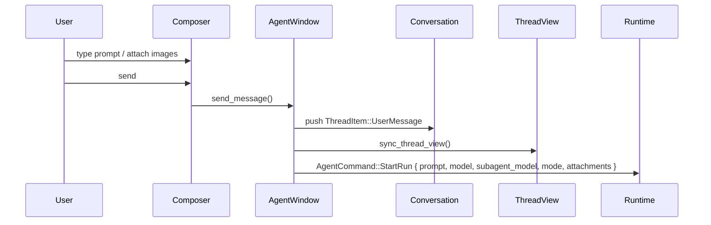

Details:

- Empty text is ignored unless image attachments exist.
- Image attachments are blocked if the selected model does not support image input.
- If no conversation exists, `ensure_send_target` creates/selects one.
- If active work exists, sending is blocked.
- The user message is pushed immediately before the runtime run starts.
- Non-`PlanOnly` messages mark the existing plan stale.
- `StartRun` includes the selected `AgentMode`, main model, and optional subagent model.

### 5.2 Runtime event mapping

Source: `crates/app/src/agent/reducer.rs`

| Event | Thread/UI effect |
| --- | --- |
| `RunStarted` | Maps `run_id` to conversation, records depth, sets status `Thinking`, inserts top-level `ReasoningStep { title: "Thinking", status: Thinking }` for depth 0 if absent. |
| `AssistantTextDelta` | Creates or appends to `AssistantMessage { streaming: true }`. Sanitizes assistant deltas. |
| `ReasoningDelta` | Creates or appends to `ReasoningStep`; buffering/coalescing is used before updating UI. |
| `ToolCallStarted` | Pauses current assistant stream, upserts `ToolCall { status: RunningTool }`; shell tools are added to command ledger. |
| `ToolCallUpdated` | Updates tool command/args preview; deduplicates rows when runtime emits a dedupe key. |
| `ToolOutputDelta` | Appends stdout/stderr text to matching `ToolCall.output`, unless tool catalog suppresses live output. Stderr gets `[stderr] ` prefix. |
| `ToolCallFinished` | Marks matching tool completed/failed/running, sets output from `body` or `summary`, updates expansion, creates terminal artifacts for shell tools. |
| `PatchPreviewUpdated` | Schedules diff preview parse for inspector/diff panel. |
| `PatchProposed` | Parses unified diff, pushes `DiffSummary`, updates diff panel, marks waiting approval unless mode auto-applies patches. |
| `PatchApplied` | Clears pending patch/approval state, marks diff applied, updates plan state. |
| `ApprovalRequested` | Marks global status `WaitingApproval`, marks tool row waiting, adds composer approval card state, optionally pushes inline `ApprovalRequest`. |
| `ChoiceRequested` | Pushes `ChoiceRequest` card with options, recommendation, custom allowance, blocking reason. |
| `TodoUpdated` | Updates `Conversation.active_todos` and plan progress header; `TodoList` is not rendered in the virtual list. |
| `ContextTrace` | Pushes `ContextTrace` row if entries are non-empty. |
| `PlanUpdated` | Stores `PlanArtifact`, selects/open plan inspector tab, syncs plan status. |
| `SubagentStarted` | Pushes `SubagentRun` row and tags child run stream state with `depth = 1` and `parent_call_id`. |
| `SubagentFinished` | Updates `SubagentRun.summary` and status. |
| `UsageUpdated` | Updates token/cost display in status/composer metadata. |
| `RunFinished` | Flushes buffers, marks assistant non-streaming, finalizes tools/reasoning, clears run state, clears approvals unless paused. |
| `RunFailed` | Finalizes in-flight rows failed, pushes `RunError`, marks plan failed. |
| `CommandFailed` | Clears pending approvals, resolves approval rows, pushes `RunError`, resets status idle. |

---

## 6. ThreadView render pipeline

### 6.1 Render entry

Source: `crates/app/src/features/chat/thread_view/render.rs`

`ThreadView::render`:

1. Clears scroll motion pause if idle.
2. Syncs composer footer measurements when in main chrome.
3. Handles scroll state changes.
4. Performs pending scroll-to-bottom if sticky bottom is active.
5. Performs pending reveal-item scroll.
6. Renders `thread-surface`.
7. If no items: renders empty state.
8. Else: renders one `v_virtual_list` using precomputed row sizes.

Simplified structure:

```text
thread-surface
  └─ thread-scroll
      └─ if empty: thread-empty-state
         else:
           thread-list
             └─ v_virtual_list(thread-virtual-list)
                 └─ render_visible(range)
```

### 6.2 Manifest projection

Source: `crates/app/src/features/chat/manifest.rs`

```mermaid
flowchart TD
    A[ThreadView.items] --> B[project_timeline(items, transcript_mode)]
    B --> C[for each TimelineEvent]
    C --> D[should_emit_thread_item]
    D -->|true| E[row_refs_for_item_with_mode]
    D -->|false| F[skip]
    E --> G[manifest Vec<RowRef>]
    G --> H[push EndSpacer]
    H --> I[row_sizes_for_manifest]
```

Important behavior:

- `TodoList` items are explicitly omitted from the virtual-list manifest.
- `ContextTrace` emits no row if it has no entries.
- `EndSpacer` is always appended so the final visible item is not hidden behind the composer.
- Row heights are estimated before rendering for virtualization.

### 6.3 Row shell

Source: `crates/app/src/features/chat/thread_view/rows.rs`

Every non-spacer row is wrapped in a fixed-height shell:

```rust
div()
    .id(element_key("thread-row-shell", &row_id))
    .w_full()
    .h(row_h)
    .when(depth > 0, |el| el.pl(Tokens::tree_indent(depth as u32)))
    .when(top_gap > 0.0, |el| el.pt(px(top_gap)))
    .overflow_hidden()
    .flex()
    .flex_col()
    .justify_start()
    .child(content)
```

This means:

- Virtual-list height is authoritative.
- Subagent/child rows with `depth > 0` are indented by tree indent tokens.
- Top spacing is encoded on header-like rows, not line/body rows.
- Overflow is clipped to avoid row bleed in the virtual list.

### 6.4 Row spacing and sizing

Sources:

- `crates/app/src/features/chat/layout.rs`
- `crates/app/src/features/chat/manifest.rs`

Key constants/functions:

| Name | Meaning |
| --- | --- |
| `turn_gap()` | Gap before a new conversational turn. Uses `Tokens::spacing_1p5()`. |
| `activity_band_gap()` | Gap before first row in an activity band. Uses `Tokens::spacing_1()`. |
| `activity_inner_gap()` | Gap between consecutive activity headers. Uses `Tokens::spacing_0p5()`. |
| `post_assistant_activity_gap()` | Gap between assistant prose and following activity rows. Uses `Tokens::spacing_1()`. |
| `HEADER_H` | Activity header height. `Tokens::TOOL_ROW_HEIGHT`. |
| `PLAN_STATUS_H` | Plan status row height. `Tokens::TOOL_ROW_HEIGHT`. |
| `LINE_H` | Monospace output line height. `Tokens::DIFF_LINE_HEIGHT`. |
| `DIFF_FILE_H` | Diff file stat row height. `Tokens::ROW_HEIGHT_SM`. |
| `APPROVAL_H` | Inline approval hint row height. `Tokens::ROW_HEIGHT_SM`. |
| `REASONING_BODY_MAX_H` | Expanded reasoning body max height: `480.0`. |
| `TOOL_OUTPUT_PREVIEW_LINES` | Max expanded output preview lines: `80`. |
| `TOOL_OUTPUT_PREVIEW_BYTES` | Max output preview bytes: `16_000`. |
| `REASONING_OUTPUT_PREVIEW_LINES` | Max expanded reasoning preview lines: `40`. |
| `REASONING_STREAMING_PREVIEW_LINES` | Collapsed streaming reasoning preview lines: `2`. |

Activity grouping is derived by `activity_group_pos(item_ix, items)`, yielding:

- `Single`
- `First`
- `Middle`
- `Last`

This lets consecutive reasoning/tool/diff/context/subagent/plan rows share a timeline band visual.

---

## 7. What each element looks like and when it appears

### 7.1 Empty thread state

Source: `render_empty_thread_state` in `crates/app/src/features/chat/thread_view/rows.rs`

Appears when `ThreadView.items.is_empty()`.

Visual:

- Centered in the thread surface.
- Max width: `Tokens::THREAD_EMPTY_COPY_WIDTH`.
- Text stack:
  - title: `Start a thread`
  - body: “Ask for a code change, inspect a file, or describe the task...”
  - faint helper: “Tool runs, reasoning, and diff summaries will appear inline beneath the reply.”

### 7.2 User message

Source: `crates/app/src/features/chat/components/message.rs`

Created by `send_message` before `StartRun` is sent.

Visual:

- Full-width flat row.
- Left accent rail: 2px wide, 18px high, accent color at 0.8 opacity.
- Label: `You`, `text_xs`, medium, tertiary text.
- Message body: `text_md`, primary text.
- Copy button: absolutely positioned top-right, opacity 0.35 by default, full opacity on hover.
- Attachments: square thumbnails using `Tokens::attachment_preview_size()`, rounded, subtle border, active surface background.
- Initial long user message may be collapsed with `See more` / `See less`.

When collapsed:

- text max height = `USER_MESSAGE_PREVIEW_LINES * LINE_LEADING`
- overflow hidden
- click `See more` toggles `ThreadItem.expanded`

### 7.3 Assistant message

Source: `ThreadView::render_assistant` in `crates/app/src/features/chat/thread_view/rows.rs`

Created by `AssistantTextDelta`; finalized on `RunFinished` by setting `streaming = false`.

Visual:

- Flat markdown text on the thread background.
- No card, no assistant bubble.
- Uses `Tokens::text_md()` and `Tokens::text_md_leading()` for non-streaming body.
- Includes a subtle action row below the message.

Streaming state:

- Renders `streaming_assistant_body` with sealed-block cache + live tail.
- Shows a static cursor (`▍`) once markdown length is greater than 2.
- If user scrolled up, shows a small `Jump to latest ↓` pill:
  - hover surface background
  - `text_xs`, tertiary text
  - on click: restores sticky bottom and scrolls to latest.
- Action row opacity is 0.40 while streaming.

Non-streaming state:

- Clears sealed streaming cache for that item.
- Uses cached parsed markdown blocks via `cached_markdown_blocks`.
- Action row opacity is 0.20 by default, 0.58 on hover.

Assistant action row:

- Always includes copy, helpful, and “needs work” buttons.
- Conditionally includes retry, open changes, and `Approval pending` text.
- Retry calls `retry_last_user_turn` when not streaming.
- Open changes opens the diff panel.

### 7.4 Reasoning row

Source: `crates/app/src/features/agent_activity/components/reasoning.rs` plus `rows.rs`

Created by `RunStarted` or `ReasoningDelta`.

Visual:

- Compact timeline/activity row.
- Header usually titled `Thinking`.
- Loading/animation depends on `AgentStatus::Thinking`.
- Collapsible.
- Grouped with adjacent activity rows using left activity rail/band treatment.

Collapsed while streaming:

- Emits `ReasoningHeader` plus up to `REASONING_STREAMING_PREVIEW_LINES` faint preview rows.
- Preview lines are the most recent non-empty reasoning lines, truncated to 200 chars each.

Expanded:

- Emits `ReasoningBody`.
- Body uses markdown preview in a `timeline_body` container.
- Max height: `480px`, with vertical scroll.

Transcript filtering:

- `Normal` and `Verbose` show reasoning rows.
- `Summary` only shows currently thinking reasoning rows.

### 7.5 Tool call row

Source: `crates/app/src/features/agent_activity/components/tool_call.rs` plus `rows.rs`

Created by `ToolCallStarted`; updated by `ToolCallUpdated`, `ToolOutputDelta`, and `ToolCallFinished`.

Visual:

- Compact activity header row.
- Label comes from `tool_row_label` / tool catalog presentation metadata.
- Detail often shows command or args preview.
- Running tools use active verbs/loading indicators.
- Waiting tools display approval-oriented summary.
- Click toggles expansion and selects the tool artifact/inspector state.
- File-related tool detail rows can open files externally.

Expanded behavior:

- If `output` exists, emits `ToolOutputLine` rows.
- If output is too long, emits `ToolOutputTruncated` with copy affordance.
- If no output yet and transcript mode shows tool output rows, emits `ToolDetailLine` rows.

Output formatting:

- Monospace.
- One virtual row per output line.
- Output preview limit: 80 lines / 16 KB.
- Stderr chunks are prefixed with `[stderr] ` in reducer.

Status mapping from protocol `ToolStatus`:

| Protocol status | UI `AgentStatus` |
| --- | --- |
| `Completed` | `Completed` |
| `Failed` | `Failed` |
| `Denied` | `Failed` |
| `Cancelled` | `Failed` |
| `Running` | `RunningTool` |

### 7.6 Diff summary row

Source: `crates/app/src/features/agent_activity/components/diff.rs` plus `rows.rs`

Created by `PatchProposed` after parsing unified diff.

Visual:

- Compact activity row summarizing changed files and additions/deletions.
- Header shows file/change counts.
- Has action to open/review changes in the diff panel.
- Expanded state emits one `DiffFileLine` per file.
- Each file line shows path and added/removed counts.

Panel behavior:

- Parsed diff files are stored in artifact/diff panel state.
- If mode auto-applies patches (`FullAccessDangerous`), `pending_patch_id = None` and `applied = true`.
- Otherwise `pending_patch_id` is set and status becomes waiting approval.

### 7.7 Context trace row

Source: `crates/app/src/features/agent_activity/components/context_trace.rs` plus `rows.rs`

Created by `ContextTrace` event when entries are non-empty.

Visual:

- Compact activity header, usually “Context” / “Used context”.
- Shows collapsed counts/details from entries.
- Click selects the Context inspector and toggles expansion.
- Expanded state emits `ContextTraceLine` rows.

Entry schema:

```rust
pub struct ContextTraceEntry {
    pub kind: ContextEntryKind,
    pub label: String,
    pub detail: Option<String>,
    pub reason: String,
}
```

Entry kinds:

- `RepoMap`
- `FileSlice`
- `Symbol`
- `Search`
- `Command`
- `Rule`

### 7.8 Approval request row

Source: `crates/app/src/features/agent_activity/components/approval.rs`

Created by `ApprovalRequested` for non-patch and non-shell tools. Patch/shell approvals are represented mainly by the tool row, composer approval card, and/or diff approval bar.

Visual:

- Inline thread hint row, not the primary action surface.
- Displays title.
- If unresolved and active: detail says `Review above the composer to continue · {risk}`.
- Actions live in the sticky composer approval card.

Risk labels:

- `Low risk`
- `Medium risk`
- `High risk`
- `Critical risk`

### 7.9 Composer approval card

Source: `approval_card` in `crates/app/src/features/agent_activity/components/approval.rs`

Appears when `AgentWindow.pending_thread_approval` is set.

Visual:

- Elevated card above composer.
- Max width: `Tokens::COMPOSER_MAX_WIDTH`.
- `surface` background, border `Tokens::approval_border()`, large radius, small shadow.
- Shows title and risk label.
- Buttons:
  - `Allow once`
  - `Deny`
  - optional `Always allow` for shell tools.

Actions:

| Button | Command |
| --- | --- |
| `Allow once` | `AgentCommand::ApproveTool` |
| `Always allow` | `AgentCommand::ApproveToolAlways` |
| `Deny` | `AgentCommand::RejectTool` |

### 7.10 Diff approval bar

Source: `diff_approval_bar` in `crates/app/src/features/agent_activity/components/approval.rs`

Appears at the bottom of the diff panel when patch approval is pending.

Visual:

- Bottom bar with panel background and top border.
- Inner rounded pill/card with surface background and subtle border.
- Shows title, risk, and actions.
- Buttons:
  - `Not now`
  - `Continue`

Actions:

| Button | Command |
| --- | --- |
| `Continue` | `AgentCommand::ApprovePatch` |
| `Not now` | `AgentCommand::RejectPatch` |

### 7.11 Choice request card

Source: `crates/app/src/features/chat/components/choice_card.rs`

Created by `ChoiceRequested`.

Visual:

- True card treatment: surface background, border, rounded radius.
- Shows summary, prompt, optional blocking reason.
- Lists options with labels/descriptions.
- Indicates recommended option.
- Shows selected/resolved state after user chooses.
- Can display custom-response hint when `allow_custom = true`.
- Unresolved card can cancel the active run.

Action:

- Selecting an option calls `submit_choice`, marks the item selected/resolved, and sends `AgentCommand::SubmitChoice { choice_id, option_id }`.

### 7.12 Run error row

Source: `crates/app/src/features/chat/components/error_card.rs`

Created by `RunFailed`, `CommandFailed`, or failure to start a run.

Visual:

- Warning/error row, flatter than a modal card.
- Shows first message line as title.
- Shows full message text.
- Can show settings action.
- Retry support is present in props, but current row use passes `on_retry: None` in `rows.rs`.

### 7.13 Plan status row

Source: `render_plan_status_row` in `rows.rs`

Created/synced from plan artifact and todo/progress state.

Visual:

- Compact activity row.
- Label: `Plan · {state.label()}`.
- Shows summary and counts such as `N pending · N active · N done · N cancelled`.
- May include source conversation id.
- Click selects the Plan inspector.

Plan states:

- `NotStarted`
- `Starting`
- `Implementing`
- `WaitingApproval`
- `Completed`
- `Failed`
- `Cancelled`
- `Stale`

### 7.14 Todo progress header

Source: `crates/app/src/window/render.rs` and todo components.

Todos are not rendered as virtual-list rows. `TodoUpdated` updates `Conversation.active_todos`, and the top-level chat column can render a `todo_progress_header` above the thread.

Visual role:

- Sticky/progress context above thread.
- Focuses on live execution checklist rather than transcript details.

### 7.15 Subagent row

Sources:

- `crates/app/src/agent/reducer.rs`
- `crates/app/src/window/bridge/subagent_bridge.rs`
- `crates/app/src/features/chat/thread_view/rows.rs`

Created by `SubagentStarted`.

Visual:

- Compact activity header row in the timeline band.
- Title: `Subagent {status}` such as `Subagent running`.
- Detail: projection activity summary, or the task if no activity summary exists.
- Shows an external/open icon button.
- Selected subagent row gets a subtle active background blend.
- Click opens/selects the subagent inspector tab.

Expanded body:

- Shows summary excerpt or fallback text: `Investigating task in child run.`
- Shows transcript activity summary.
- Shows last event label if available.

Subagent child rows:

- Child assistant/reasoning/tool/diff rows are normal `ThreadItem`s tagged with:
  - `depth: 1`
  - `parent_call_id: Some(delegate_call_id)`
- The main virtual row shell indents `depth > 0` items using `Tokens::tree_indent(depth)`.
- The subagent inspector builds an embedded `ThreadView` containing only the child items linked to the subagent.

---

## 8. Mode-specific user flows

### 8.1 Ask mode (`ChatOnly`)

Composer chip: `Ask`.

Capabilities:

- No file reads.
- No virtual bash.
- No patch proposals.
- No patch apply.
- No real commands.

Expected UI flow:

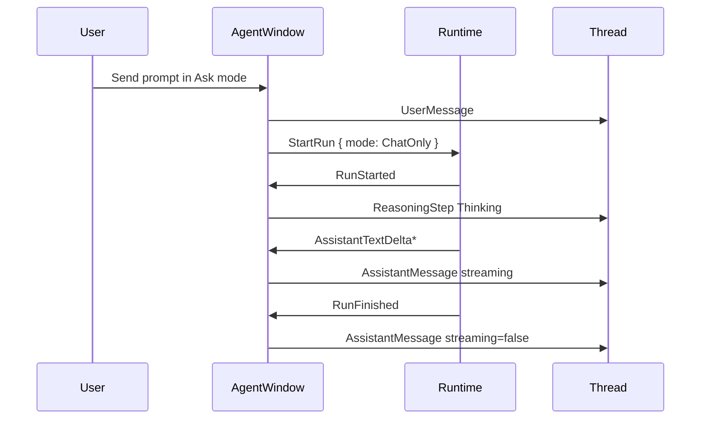

What appears:

- User row.
- Thinking/reasoning row may appear depending on runtime events and transcript mode.
- Assistant markdown response.
- Usually no tool, diff, approval, context trace, or subagent rows because tools are unavailable.

### 8.2 Plan mode (`PlanOnly`)

Composer chip: `Plan`.

Capabilities:

- Can read files.
- Can run virtual bash.
- Cannot propose or apply patches.
- Cannot run real commands.

Expected UI flow:

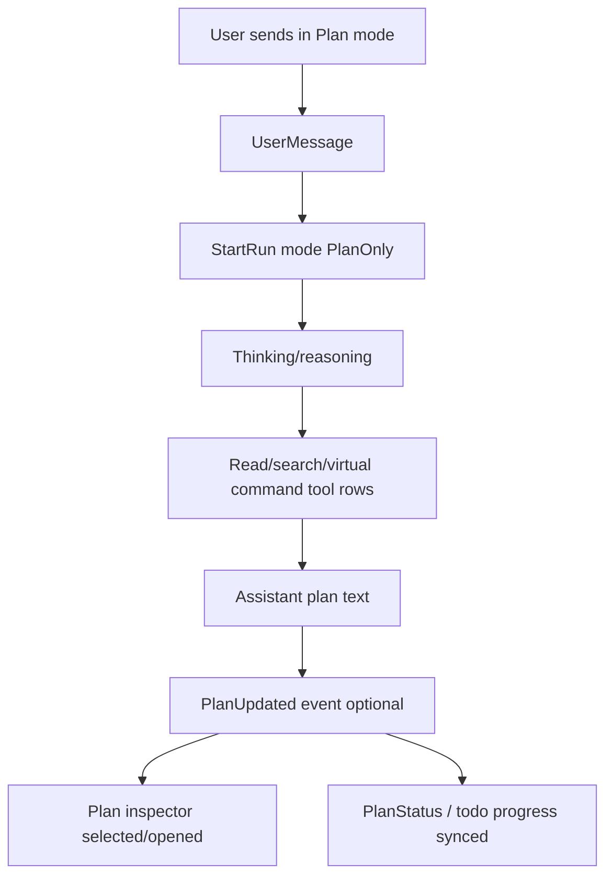

What appears:

- User row.
- Reasoning rows.
- Read/search/virtual shell tool rows if the runtime uses tools.
- Assistant planning response.
- Plan inspector opens when `PlanUpdated` arrives.
- Active todo/progress header may update through `TodoUpdated`.
- No patch/diff apply flow should occur from this mode.

### 8.3 Edit mode (`SuggestPatch`)

Composer chip: `Edit`.

Capabilities:

- Can read files and run virtual bash.
- Can propose patches.
- Cannot apply patches.
- Cannot run real commands.

Expected UI flow:

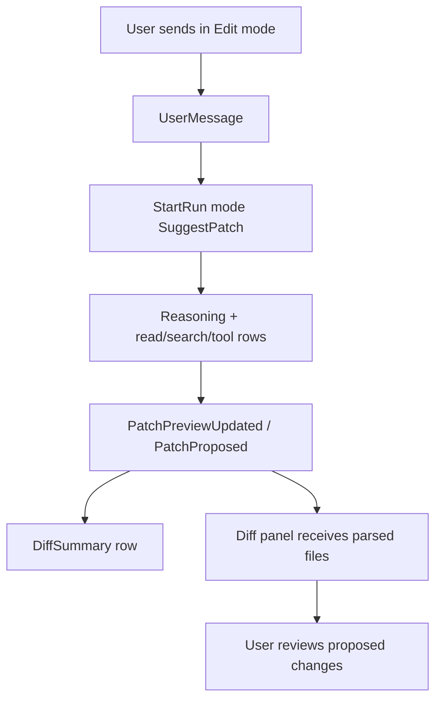

What appears:

- User row.
- Tool/reasoning rows.
- Diff summary row when a patch is proposed.
- Diff panel opens/updates with parsed files.
- Because this mode cannot apply patches, it should behave like proposal/review mode. The reducer still marks non-auto patch proposals as pending in diff state; runtime/tool policy determines whether an actual apply approval path is available.

### 8.4 Apply mode (`ApplyWithApproval`)

Composer chip: `Apply`.

Capabilities:

- Can read files.
- Can run virtual bash.
- Can propose patches.
- Can apply patches.
- Can run real commands.
- Does not auto-apply patches.

Expected UI flow:

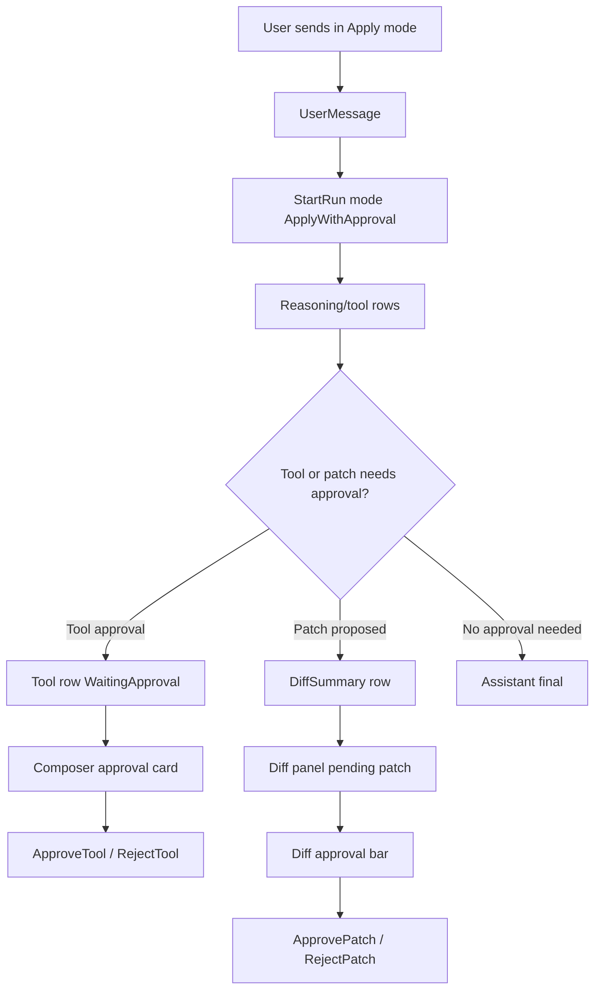

What appears:

- User row.
- Reasoning and tool activity.
- Tool rows can switch to `WaitingApproval`.
- Sticky composer approval card appears for pending tool approval.
- Patch proposals render a diff summary row and diff panel state.
- Patch application waits for explicit approval.

### 8.5 Agent mode (`FullAccessDangerous`)

Composer chip: `Agent`.

Capabilities:

- Can read files.
- Can run virtual bash.
- Can propose patches.
- Can apply patches.
- Can run real commands.
- Auto-applies patches according to `AgentMode::auto_applies_patches()`.

Expected UI flow:

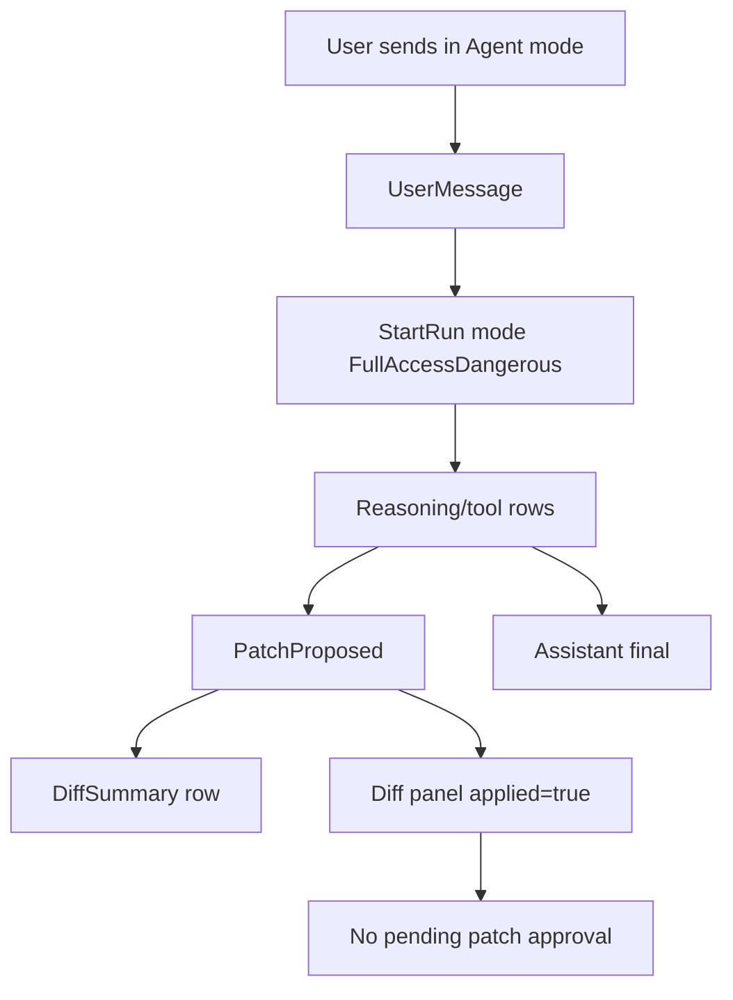

What appears:

- Same thread rows as Apply mode.
- Patch proposals still create `DiffSummary` and update diff panel.
- Reducer sets `pending_patch_id = None` and `applied = true` when auto-apply is active.
- Some dangerous real-command/tool approvals may still appear if runtime/tool policy emits `ApprovalRequested`; the composer tooltip says “minimal gates,” not “no gates.”

### 8.6 ReadOnlyInspect mode

Settings-only mode in current UI.

Capabilities:

- Can read files.
- Can run virtual bash.
- Cannot propose or apply patches.
- Cannot run real commands.

Expected UI:

- Similar to Plan mode, but not specifically plan-artifact oriented.
- Likely shows reasoning, read/search/virtual command rows, context traces, and assistant answer.

### 8.7 AutoSafe mode

Settings-only mode in current UI.

Capabilities according to protocol:

- Can read files.
- Can run virtual bash.
- Can propose and apply patches.
- Can run real commands.
- Does **not** auto-apply patches in the current `auto_applies_patches()` implementation; only `FullAccessDangerous` does.

Expected UI:

- Similar to Apply mode, with runtime/tool policy deciding when approvals are requested.

---

## 9. Subagent/delegation flow

Subagents are represented as normal child run events plus projection metadata. There is not a separate bespoke transcript protocol in the UI.

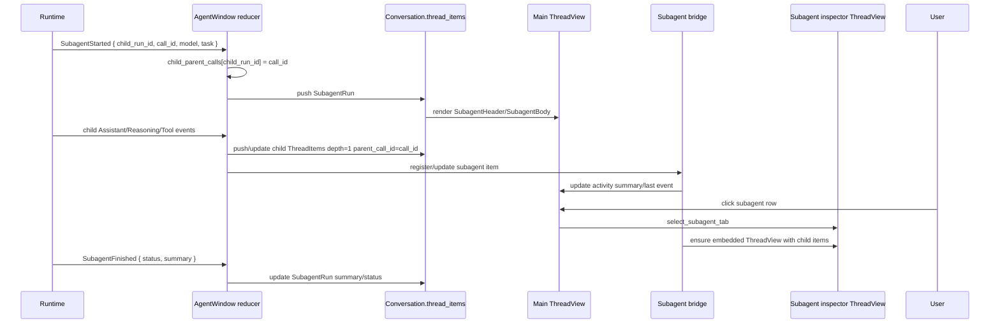

### Projection schema

Source: `crates/app/src/window/types.rs`

```rust
pub(crate) struct SubagentTranscript {
    item_id: String,
    parent_call_id: String,
    task: String,
    model: String,
    summary: String,
    status: AgentStatus,
    assistant_count: usize,
    reasoning_count: usize,
    tool_count: usize,
    diff_count: usize,
    last_event_label: Option<String>,
    item_ids: Vec<String>,
    view: Option<Entity<ThreadView>>,
}
```

Displayed surfaces:

| Surface | What it shows |
| --- | --- |
| Main thread `SubagentHeader` | Status, task/activity summary, selected state, open icon. |
| Main thread `SubagentBody` | Summary/fallback, activity summary, last event label. |
| Inspector subagent tab | Header `Subagent`, task, model/status, summary, embedded child `ThreadView`. |
| Child rows in main thread | Normal rows with `depth = 1`, indented by tree tokens. |

---

## 10. Approval flow details

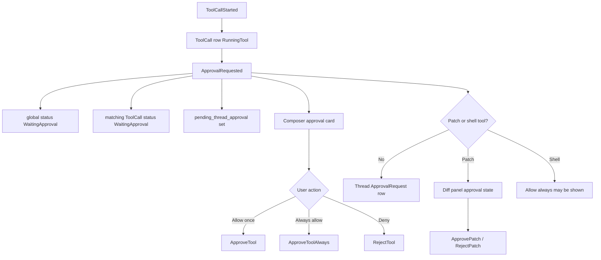

Important behavior:

- Inline thread approval rows are hints; composer/diff panel surfaces own actions.
- `begin_approval_resolution` clears pending approval UI, marks waiting tools back to running, resolves approval rows, and resumes status.
- `clear_pending_approval_ui` clears pending approval state and resolves thread approval items.
- Shell tool approvals may include `Always allow`.
- Patch approvals appear in the diff panel approval bar.

---

## 11. Choice/request-user flow

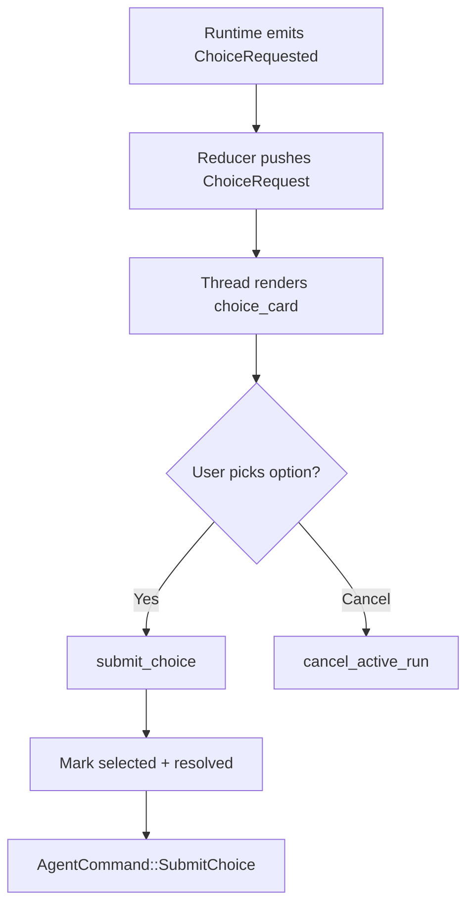

The choice card is one of the few actual cards in the thread because it blocks the run and requires user input.

---

## 12. Streaming, caching, and scroll behavior

### 12.1 Streaming model

Current code path:

- Streaming assistant text is rendered inline in `v_virtual_list`.
- `ThreadView` uses coalesced updates rather than a separate hot-tail overlay.
- `sync.rs` has optimized patch paths, including `patch_streaming_assistant_row`, to avoid rebuilding the full manifest on every token.

Streaming-related constants from `sync.rs` summary:

- `STREAM_FRAME_SYNC_MS = 8`
- `ASSISTANT_STREAM_SYNC_MS = 33`
- `STREAM_BATCH_SLOW_MS = 33`
- `STREAM_BATCH_BACKPRESSURE_MS = 66`

### 12.2 Markdown and output caches

Source: `crates/app/src/features/chat/thread_view/caches.rs`

Caches include:

- `MarkdownCacheEntry`: parsed assistant markdown blocks.
- `ToolOutputPreview`: truncated output preview and full output for copy.
- `sealed_blocks`: stable parsed chunks for streaming assistant content.

Behavior:

- Non-streaming assistant markdown uses cached parsed blocks.
- Streaming assistant output splits stable/sealed markdown from live tail.
- Tool output preview is cached by item id/output content.
- Height estimates combine cached parse estimates and accessory/action heights.

### 12.3 Scroll behavior

Source: `crates/app/src/features/chat/thread_view/scroll.rs`

Behavior:

- Sticky-to-bottom is maintained while the user has not scrolled away.
- If the scroll offset indicates user scrolled up, `user_scrolled_up = true` and `stick_to_bottom = false`.
- Streaming assistant rows show `Jump to latest ↓` when user is scrolled up.
- Scrolling pauses motion/animation for a short period to avoid expensive animation during scroll.
- `EndSpacer` height accounts for composer overlay/footer so the last row is not hidden behind the composer.

---

## 13. Visual design rules visible in the implementation

The code follows the repository rule: flat first, cards only for input/blocking surfaces.

| Element | Visual treatment |
| --- | --- |
| User message | Flat row, accent rail, no bubble card. |
| Assistant message | Flat markdown text on thread background. |
| Assistant actions | Low-opacity icon row, stronger on hover. |
| Reasoning/tool/diff/context/subagent | Compact timeline rows with activity grouping/left detail borders. |
| Expanded output/detail lines | Indented, left border, subdued text; monospace for tool output. |
| Choice request | Card because it requires user input. |
| Composer approval | Elevated card because it blocks continuation. |
| Diff approval | Bottom panel bar with rounded inner action surface. |
| Sidebar/thread read-only rows | Flat rows, hover/active backgrounds, not persistent cards. |

Tokens are used consistently for spacing, radius, text sizes, row heights, and colors.

---

## 14. Row variant matrix

| `ThreadItem` | `RowRef` emitted | When emitted | Main renderer | Look |
| --- | --- | --- | --- | --- |
| `UserMessage` | `UserMessage` | Always if not filtered | `user_message` | Flat user row with accent rail, `You` label, copy, attachments. |
| `AssistantMessage` | `AssistantMessage` | Always, except summary mode hides intermediate completed assistant messages | `render_assistant` | Flat markdown text plus subtle action row. |
| `SubagentRun` | `SubagentHeader`, maybe `SubagentBody` | Hidden in summary mode; body when expanded | local subagent render helpers | Compact activity row, open icon, selected background when active. |
| `ReasoningStep` | `ReasoningHeader`, maybe preview/body | Normal/Verbose; summary only while thinking | reasoning components + markdown body | Compact thinking row; preview lines while streaming collapsed; scrollable body expanded. |
| `ToolCall` | `ToolHeader`, detail/output/truncated rows | Always except summary only shows running/waiting | tool call components | Compact tool row; output lines monospace when expanded. |
| `DiffSummary` | `DiffHeader`, maybe `DiffFileLine`s | Hidden in summary mode | diff components | Compact changes row; file lines when expanded. |
| `ContextTrace` | `ContextTraceHeader`, maybe `ContextTraceLine`s | Hidden in summary mode; omitted if empty | context trace components | Compact used-context row; evidence/detail rows expanded. |
| `ApprovalRequest` | `Approval` | Always in normal/verbose; summary shows too | `thread_approval_row` | Inline hint row; actions live above composer. |
| `ChoiceRequest` | `ChoiceRequest` | Always | `choice_card` | Input/blocking card with options and selected/recommended states. |
| `RunError` | `RunError` | Always | `error_card` | Flat warning/error row. |
| `PlanStatus` | `PlanStatus` | Hidden in summary mode | `render_plan_status_row` | Compact plan state/progress row. |
| `TodoList` | none | Never in thread manifest | n/a | Todos surface through active todo/progress header. |
| n/a | `EndSpacer` | Always appended | spacer div | Invisible bottom clearance for composer. |

---

## 15. Notable implementation observations

1. **Provider events are normalized early.** The UI only renders `ThreadItem`/`RowRef`, not provider-native events.
2. **Thread state is plain data.** `features/shell/state.rs` intentionally contains pure data with no GPUI rendering.
3. **Virtualization is central.** The thread uses one `v_virtual_list` with fixed/precomputed row sizes.
4. **Streaming uses inline row patching.** Current code does not implement a separate visual hot-tail layer despite architecture notes mentioning one.
5. **Subagents are projections over child rows.** Child activity is linked by `parent_call_id`, counted/projected in `SubagentTranscript`, and optionally shown in an embedded `ThreadView`.
6. **Approvals have three surfaces.** Inline hint row, sticky composer approval card, and diff-panel approval bar.
7. **Transcript mode is a major display filter.** `Summary` hides most completed activity; `Verbose` exposes tool output rows.
8. **Composer and settings expose different mode subsets.** This is intentional in the current code or at least current behavior.
9. **Mode/model from `RunStarted` is not the main display source.** Visible model/mode mostly come from selected window state/status, not the event payload.
10. **Todo updates are not thread rows.** They update active todo/progress state above the thread.

---

## 16. Quick reference: common flows

### Normal answer flow

```text
UserMessage
ReasoningStep Thinking
AssistantMessage streaming
AssistantMessage completed
```

### Tool-use flow

```text
UserMessage
ReasoningStep
ToolCall RunningTool
ToolCall Completed/Failed
AssistantMessage
```

### Approval flow

```text
ToolCall RunningTool
ApprovalRequested
ToolCall WaitingApproval
Composer approval card
Approve/Reject command
ToolCall RunningTool or Failed
AssistantMessage / RunError
```

### Patch flow

```text
ToolCall edit/propose patch
PatchPreviewUpdated optional
PatchProposed
DiffSummary row
Diff panel files
Approval/apply bar unless FullAccessDangerous auto-applies
PatchApplied
AssistantMessage final
```

### Subagent flow

```text
SubagentRun RunningTool
Child ReasoningStep depth=1
Child ToolCall depth=1
Child AssistantMessage depth=1
SubagentRun Completed/Failed with summary
Subagent inspector embedded transcript optional
```

### Choice flow

```text
ChoiceRequested
ChoiceRequest card
User selects option
ChoiceRequest resolved/selected
SubmitChoice command
Run continues
```
